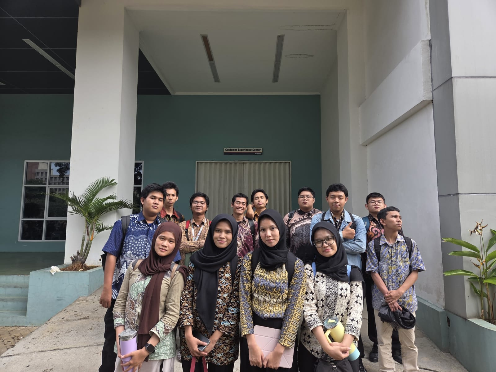

# Pendapat dan Dokumentasi Lokakarya Proyek Hari 1

## Identitas Peserta
- **Nama:** Muhammad Fayaz Rizki
- **Nama Kelompok:** Crazy Taxi
- **Kegiatan:** Lokakarya Proyek Hari 1

## Pendapat Saya tentang Workshop

Menurut saya, kegiatan Lokakarya Proyek Hari 1 sangat menarik dan bermanfaat. Dari kegiatan ini, saya mendapatkan banyak pengalaman serta pengetahuan baru yang sebelumnya belum saya ketahui.

Selama mengikuti workshop, saya belajar mengenai penggunaan GitHub, cara membuat repository, mengunggah file, serta menyusun dokumentasi dengan rapi. Awalnya saya merasa sedikit kesulitan karena masih belum terlalu memahami cara menggunakan GitHub. Namun, setelah mengikuti arahan dan mencoba secara langsung, saya mulai mengerti langkah-langkahnya.

Selain mendapatkan ilmu baru, kegiatan ini juga mengajarkan saya pentingnya kerja sama, ketelitian, dan tanggung jawab dalam mengerjakan sebuah proyek.

Saya merasa senang bisa mengikuti kegiatan ini bersama kelompok Crazy Taxi. Semoga pada workshop berikutnya saya bisa mendapatkan lebih banyak pengalaman dan meningkatkan kemampuan dalam mengerjakan proyek.

## Dokumentasi Foto Kegiatan

Berikut merupakan dokumentasi foto selama mengikuti kegiatan Lokakarya Proyek Hari 1.

### Foto 1 – Kegiatan Workshop

### Foto 2 – Dokumentasi Pembelajaran

### Foto 3 – Kegiatan Bersama Kelompok Crazy Taxi
## Dokumentasi Foto Kegiatan

## Kesimpulan

Kegiatan Lokakarya Proyek Hari 1 memberikan pengalaman yang berharga bagi saya. Saya berharap ilmu yang didapatkan bisa bermanfaat dan diterapkan dalam kegiatan proyek selanjutnya.
